# 基于疫情防控管理系统的数据可视化分析与实现3mkgh

> 🎓 **计算机毕业设计 · 基于疫情防控管理系统的数据可视化分析与实现3mkgh**
>
> 本仓库只放**项目介绍 + 运行截图**（截图是站点带水印的原图，存在仓库 `images/` 里）。
>
> 👉 **完整可运行源码 / 数据库脚本 / 部署文档：[点我获取](https://geekcode.top/archives/%E5%9F%BA%E4%BA%8E%E7%96%AB%E6%83%85%E9%98%B2%E6%8E%A7%E7%AE%A1%E7%90%86%E7%B3%BB%E7%BB%9F%E7%9A%84%E6%95%B0%E6%8D%AE%E5%8F%AF%E8%A7%86%E5%8C%96%E5%88%86%E6%9E%90%E4%B8%8E%E5%AE%9E%E7%8E%B03mkgh?utm_source=github)**
>
> 💬 咨询微信：**ir9372**　|　🌐 更多项目：[极客代码 geekcode.top](https://geekcode.top/?utm_source=github)
>
> 📌 项目详情页：<https://geekcode.top/archives/%E5%9F%BA%E4%BA%8E%E7%96%AB%E6%83%85%E9%98%B2%E6%8E%A7%E7%AE%A1%E7%90%86%E7%B3%BB%E7%BB%9F%E7%9A%84%E6%95%B0%E6%8D%AE%E5%8F%AF%E8%A7%86%E5%8C%96%E5%88%86%E6%9E%90%E4%B8%8E%E5%AE%9E%E7%8E%B03mkgh?utm_source=github>

<table><td width="230" align="center"> <b>扫码加微信 ir9372</b></td><td valign="middle">📦 源码 = 项目介绍 + 全部运行截图 + 数据库 + 部署文档 👉 点上方任意截图，直接跳到 <b>极客代码 geekcode.top</b> 详情页</td></table>

---

<h1>基于疫情防控管理系统的数据可视化分析与实现_3mkgh</h1>
<h2>项目概述</h2>

本项目旨在构建一个基于 Spring Boot 和 Vue 前后端分离架构的疫情防控管理系统，核心目标是通过数据可视化技术辅助防疫决策与公众信息服务。系统包含前台用户端与后台管理端，主要功能涵盖核酸检测点查询、核酸预约、结果查看、疫情资讯发布、全国及国内实时动态展示以及系统留言互动。适用人群包括普通市民（用于查询防疫信息、预约检测）和系统管理员（用于维护基础数据、审核留言及管理内容）。技术架构上，后端采用 Spring Boot 结合 MyBatis-Plus 进行高效数据持久化操作，使用 Apache Shiro 实现权限控制；前端基于 Vue 框架集成开发，通过 RESTful API 与后端交互，实现了数据的高效渲染与可视化展示。

<h2>技术架构</h2>
<h3>1. 总体架构设计</h3>

系统采用经典的前后端分离模式（Vue-integrated），整体分为表现层、业务逻辑层和数据访问层。

<a href="https://geekcode.top/archives/%E5%9F%BA%E4%BA%8E%E7%96%AB%E6%83%85%E9%98%B2%E6%8E%A7%E7%AE%A1%E7%90%86%E7%B3%BB%E7%BB%9F%E7%9A%84%E6%95%B0%E6%8D%AE%E5%8F%AF%E8%A7%86%E5%8C%96%E5%88%86%E6%9E%90%E4%B8%8E%E5%AE%9E%E7%8E%B03mkgh?utm_source=github" title="查看完整源码">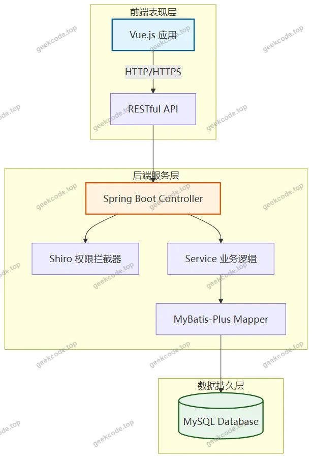</a>

<h3>2. 核心技术选型</h3>
<ul>
<li><strong>后端框架</strong>: 选用 <strong>Spring Boot</strong> 作为基础框架，利用其自动配置特性简化开发流程，快速搭建 Web 服务。</li>
<li><strong>ORM 框架</strong>: 采用 <strong>MyBatis-Plus</strong>，在保留 MyBatis 灵活 SQL 编写能力的同时，提供了通用的 CRUD 接口，显著减少样板代码，提升数据库操作效率。</li>
<li><strong>安全框架</strong>: 集成 <strong>Apache Shiro</strong>，负责系统的身份认证（Authentication）和授权（Authorization），确保后台管理接口的安全性及用户操作的合法性。</li>
<li><strong>数据库</strong>: 使用 <strong>MySQL</strong> 存储结构化数据，包括用户信息、核酸检测记录、疫情统计数据等。</li>
<li><strong>前端技术</strong>: 基于 <strong>Vue</strong> 生态体系，配合 Element UI 或类似组件库（根据常规 Vue 项目推断，虽未明确列出 UI 库但存在大量表单列表页）构建响应式界面，实现数据的可视化图表展示。</li>
</ul>
<h3>3. 数据库设计要点</h3>

根据控制器列表分析，数据库主要包含以下核心实体表：

<ul>
<li><strong>用户相关</strong>: <code>yonghu</code> (用户表), <code>fangyirenyuan</code> (防疫人员表)。</li>
<li><strong>业务数据</strong>: <code>hesuanjiancedian</code> (核酸检测点), <code>hesuanjianceyuyue</code> (核酸预约), <code>hesuanjieguo</code> (核酸结果)。</li>
<li><strong>资讯与统计</strong>: <code>news</code> (疫情资讯), <code>qgsssj</code> (全国实时数据), <code>gnssdt</code> (国内实时动态)。</li>
<li><strong>系统配置</strong>: <code>config</code> (系统参数), <code>messages</code> (系统留言), <code>aboutus</code> (关于我们), <code>systemintro</code> (系统简介), <code>board</code> (公告/轮播图)。</li>
</ul>
<h2>功能模块</h2>
<h3>1. 前台用户端</h3>

前台面向普通公众，提供信息查询与服务办理功能，无需登录即可浏览大部分公开数据，部分操作需用户身份验证。

<table>
<thead>
<tr>
<th align="left">模块名称</th>
<th align="left">功能描述</th>
</tr>
</thead>
<tbody><tr>
<td align="left"><strong>首页</strong></td>
<td align="left">展示系统核心入口，包含轮播图公告、最新疫情资讯摘要及快捷导航链接。</td>
</tr>
<tr>
<td align="left"><strong>核酸检测点</strong></td>
<td align="left">展示各区域核酸检测点的地理位置、开放时间、联系电话等信息，支持列表浏览。</td>
</tr>
<tr>
<td align="left"><strong>疫情资讯</strong></td>
<td align="left">发布官方或权威渠道的疫情防控新闻、政策通知及科普知识。</td>
</tr>
<tr>
<td align="left"><strong>系统留言</strong></td>
<td align="left">提供用户反馈通道，允许注册用户提交咨询建议或投诉意见。</td>
</tr>
<tr>
<td align="left"><strong>个人中心</strong></td>
<td align="left">用户登录后访问，可查看个人信息、修改密码，并管理个人的核酸检测预约记录及查看检测结果。</td>
</tr>
<tr>
<td align="left"><strong>核酸预约</strong></td>
<td align="left">用户选择指定检测点进行在线预约，填写必要身份信息以生成预约单。</td>
</tr>
<tr>
<td align="left"><strong>核酸结果</strong></td>
<td align="left">用户查询个人核酸检测的历史记录及当前状态（阴性/阳性/待出结果）。</td>
</tr>
<tr>
<td align="left"><strong>实时数据</strong></td>
<td align="left">展示全国及国内的疫情实时统计数据，通常以表格或简单图表形式呈现确诊、治愈、死亡人数等关键指标。</td>
</tr>
</tbody></table>
<h3>2. 后台管理端</h3>

后台面向系统管理员，具备完整的 CRUD（增删改查）权限，用于维护系统运行所需的基础数据和内容。

<table>
<thead>
<tr>
<th align="left">模块名称</th>
<th align="left">路由路径</th>
<th align="left">功能描述</th>
</tr>
</thead>
<tbody><tr>
<td align="left"><strong>系统登录</strong></td>
<td align="left"><code>/login</code></td>
<td align="left">管理员身份认证入口，基于 Shiro 进行账号密码校验。</td>
</tr>
<tr>
<td align="left"><strong>仪表盘</strong></td>
<td align="left"><code>/board</code></td>
<td align="left">后台首页，可能包含关键数据统计概览或快捷操作入口。</td>
</tr>
<tr>
<td align="left"><strong>防疫人员管理</strong></td>
<td align="left"><code>/fangyirenyuan</code></td>
<td align="left">维护防疫工作人员的基本信息，如姓名、职务、联系方式等。</td>
</tr>
<tr>
<td align="left"><strong>国内实时动态</strong></td>
<td align="left"><code>/gnssdt</code></td>
<td align="left">录入和管理国内各地的疫情动态新闻或通报信息。</td>
</tr>
<tr>
<td align="left"><strong>疫情资讯管理</strong></td>
<td align="left"><code>/news</code></td>
<td align="left">发布、编辑、删除前台展示的疫情相关新闻文章。</td>
</tr>
<tr>
<td align="left"><strong>关于我们</strong></td>
<td align="left"><code>/aboutus</code></td>
<td align="left">编辑系统介绍页面内容，维护平台背景信息。</td>
</tr>
<tr>
<td align="left"><strong>系统简介</strong></td>
<td align="left"><code>/systemintro</code></td>
<td align="left">配置系统整体的简要说明文本。</td>
</tr>
<tr>
<td align="left"><strong>核酸结果管理</strong></td>
<td align="left"><code>/hesuanjieguo</code></td>
<td align="left">录入、更新用户的核酸检测结果数据，支持批量导入或手动添加。</td>
</tr>
<tr>
<td align="left"><strong>用户管理</strong></td>
<td align="left"><code>/yonghu</code></td>
<td align="left">查看注册用户列表，重置密码，禁用违规账号等操作。</td>
</tr>
<tr>
<td align="left"><strong>全国实时数据</strong></td>
<td align="left"><code>/qgsssj</code></td>
<td align="left">维护全国范围内的宏观疫情统计数据，供前台展示。</td>
</tr>
<tr>
<td align="left"><strong>核酸预约管理</strong></td>
<td align="left"><code>/hesuanjianceyuyue</code></td>
<td align="left">查看所有用户的预约记录，处理异常预约，导出预约名单。</td>
</tr>
<tr>
<td align="left"><strong>系统留言管理</strong></td>
<td align="left"><code>/messages</code></td>
<td align="left">查看、回复或删除前台用户提交的留言反馈。</td>
</tr>
<tr>
<td align="left"><strong>系统配置</strong></td>
<td align="left"><code>/config</code></td>
<td align="left">设置系统全局参数，如网站标题、Logo、默认分页大小等。</td>
</tr>
<tr>
<td align="left"><strong>核酸检测点管理</strong></td>
<td align="left"><code>/hesuanjiancedian</code></td>
<td align="left">新增、编辑、删除核酸检测点信息，维护点位地图坐标及服务能力。</td>
</tr>
<tr>
<td align="left"><strong>轮播图管理</strong></td>
<td align="left"><em>(隐含于 board 或 config)</em></td>
<td align="left">管理首页展示的轮播图片资源，设置跳转链接。</td>
</tr>
</tbody></table>
<h2>用户角色与权限</h2>

系统基于 Apache Shiro 框架实现细粒度的权限控制，主要划分为以下两类角色：

<h3>1. 普通用户 (User)</h3>
<ul>
<li><strong>定义</strong>: 在前台注册的市民或访客。</li>
<li><strong>权限范围</strong>:</li>
<li><strong>读取权限</strong>: 可浏览所有公开的疫情资讯、检测点信息、实时数据及公告。</li>
<li><strong>写入权限</strong>: 仅限个人数据操作，包括注册账号、修改个人资料、提交系统留言、发起核酸预约、查看自己的核酸结果。</li>
<li><strong>限制</strong>: 无法访问后台管理接口，无法查看其他用户的隐私数据。</li>
</ul>
<h3>2. 管理员 (Admin)</h3>
<ul>
<li><strong>定义</strong>: 拥有后台登录凭证的系统运维人员或卫生部门工作人员。</li>
<li><strong>权限范围</strong>:</li>
<li><strong>完全控制权</strong>: 对系统中所有数据实体（用户、检测点、预约、结果、资讯、留言、配置等）拥有创建、读取、更新、删除（CRUD）的权限。</li>
<li><strong>审核权</strong>: 对用户提交的留言进行处理，对异常数据进行修正。</li>
<li><strong>配置权</strong>: 修改系统全局配置，管理轮播图和公告内容。</li>
<li><strong>隔离性</strong>: 管理员账号与普通用户账号体系独立，互不干扰，确保数据安全。</li>
</ul>
<h2>项目特色与创新点</h2>
<ol>
<li><strong>数据可视化与实时性结合</strong>: 项目不仅提供静态的信息展示，还专门设计了“全国实时数据”和“国内实时动态”模块，能够直观反映疫情态势，为公众提供及时的数据参考，体现了系统在公共卫生信息传播方面的时效性价值。</li>
<li><strong>闭环的服务流程</strong>: 涵盖了从“信息发布”到“服务预约”再到“结果反馈”的完整业务链条。用户可以通过前台完成核酸点的查找、预约检测，并最终在线获取检测结果，减少了线下排队和纸质报告领取的成本，提升了防疫服务的数字化水平。</li>
<li><strong>轻量级高可用的技术栈</strong>: 采用 Spring Boot + MyBatis-Plus + Shiro 的组合，既保证了企业级应用的稳定性和安全性，又通过 MyBatis-Plus 简化了复杂 SQL 的处理，使得系统在应对高频查询（如实时数据刷新）时具有良好的性能表现。</li>
<li><strong>灵活的后台内容管理</strong>: 后台将资讯、动态、公告、检测点等信息解耦为独立的管理模块，支持管理员根据疫情发展阶段灵活调整前台展示的重点内容，增强了系统的适应性和运营效率。</li>
</ol>
<h2>部署环境</h2>

为了确保项目的顺利运行，需准备以下软硬件环境：

<h3>1. 硬件环境</h3>
<ul>
<li><strong>服务器</strong>: 推荐 CPU 2核及以上，内存 4GB 及以上，硬盘空间 50GB 以上。</li>
<li><strong>开发机</strong>: Windows/macOS/Linux 任意操作系统，具备基本编程能力。</li>
</ul>
<h3>2. 软件环境</h3>
<ul>
<li><strong>JDK</strong>: Java Development Kit 1.8 或更高版本（Spring Boot 2.x 兼容 JDK 8+）。</li>
<li><strong>Maven</strong>: Apache Maven 3.6 及以上版本，用于依赖管理和项目构建。</li>
<li><strong>数据库</strong>: MySQL 5.7 或 8.0 版本，需安装相应的 JDBC 驱动（mysql-connector-java）。</li>
<li><strong>Node.js</strong>: Node.js 14.x 或 16.x LTS 版本，用于前端 Vue 项目的依赖安装与编译打包。</li>
<li><strong>Web 服务器</strong>: Nginx（可选，用于生产环境静态资源托管及反向代理）或内置 Tomcat（Spring Boot 自带）。</li>
<li><strong>IDE</strong>: IntelliJ IDEA 或 Eclipse（后端开发），VS Code（前端开发）。</li>
</ul>
<h3>3. 依赖组件</h3>
<ul>
<li><strong>Spring Boot Starter Web</strong>: 提供 Web 服务能力。</li>
<li><strong>MyBatis Plus &amp; MyBatis Spring Boot Starter</strong>: 数据持久层支持。</li>
<li><strong>Shiro Spring</strong>: 安全权限控制。</li>
<li><strong>Protobuf Java</strong>: 数据处理序列化支持。</li>
<li><strong>Commons Lang3 / Validation API</strong>: 工具类及数据校验支持。</li>
</ul>
<h2>五、技术特性</h2>
<ul>
<li>前后端集成部署，前端资源打包至后端 static 目录</li>
<li>使用 MyBatis-Plus 简化数据访问层开发</li>
<li>集成 Shiro 权限框架实现角色权限控制</li>
</ul>
<h2>六、功能模块截图</h2>
<h3>前台用户端</h3>
<h4>前台-防疫人员列表</h4>

<a href="https://geekcode.top/archives/%E5%9F%BA%E4%BA%8E%E7%96%AB%E6%83%85%E9%98%B2%E6%8E%A7%E7%AE%A1%E7%90%86%E7%B3%BB%E7%BB%9F%E7%9A%84%E6%95%B0%E6%8D%AE%E5%8F%AF%E8%A7%86%E5%8C%96%E5%88%86%E6%9E%90%E4%B8%8E%E5%AE%9E%E7%8E%B03mkgh?utm_source=github" title="查看完整源码">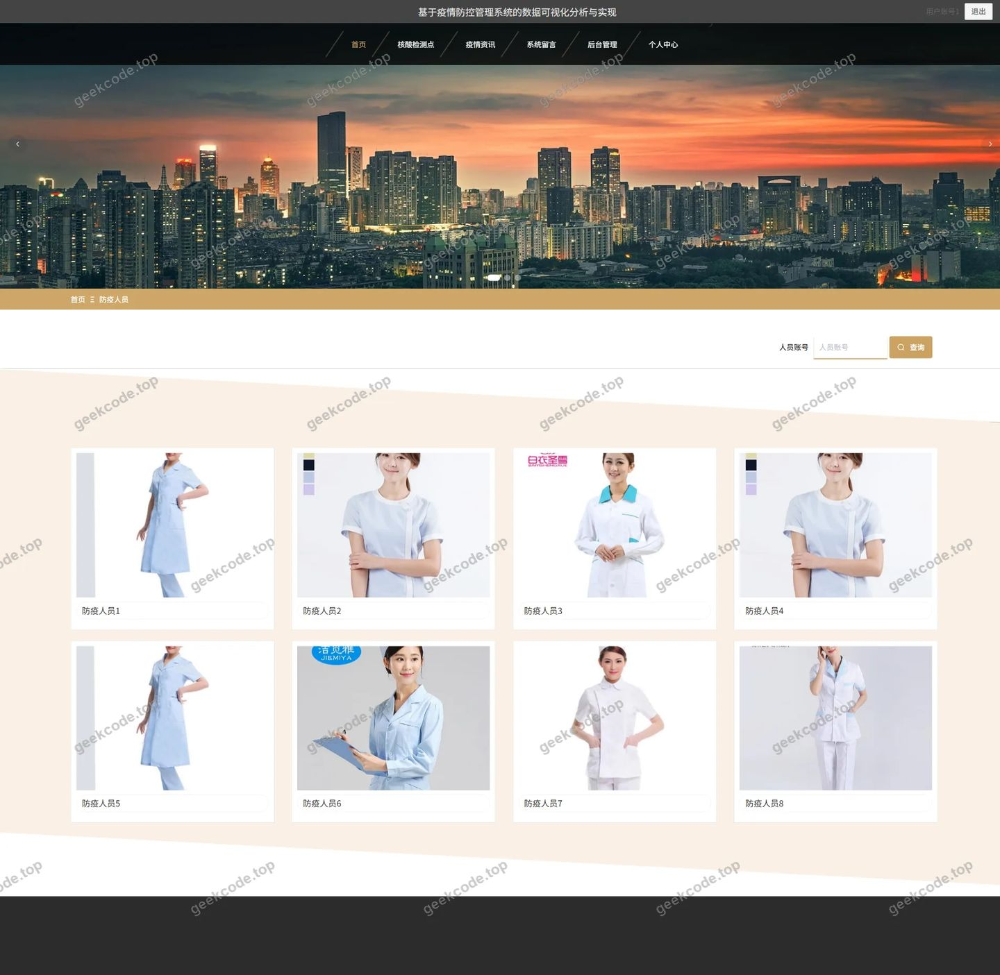</a>

<h4>前台-国内实时动态列表</h4>

<a href="https://geekcode.top/archives/%E5%9F%BA%E4%BA%8E%E7%96%AB%E6%83%85%E9%98%B2%E6%8E%A7%E7%AE%A1%E7%90%86%E7%B3%BB%E7%BB%9F%E7%9A%84%E6%95%B0%E6%8D%AE%E5%8F%AF%E8%A7%86%E5%8C%96%E5%88%86%E6%9E%90%E4%B8%8E%E5%AE%9E%E7%8E%B03mkgh?utm_source=github" title="查看完整源码">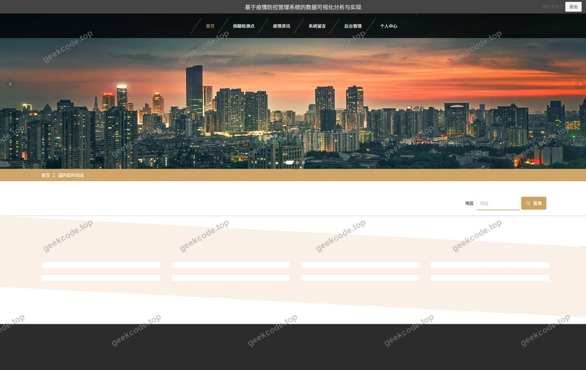</a>

<h4>前台-核酸检测点列表</h4>

<a href="https://geekcode.top/archives/%E5%9F%BA%E4%BA%8E%E7%96%AB%E6%83%85%E9%98%B2%E6%8E%A7%E7%AE%A1%E7%90%86%E7%B3%BB%E7%BB%9F%E7%9A%84%E6%95%B0%E6%8D%AE%E5%8F%AF%E8%A7%86%E5%8C%96%E5%88%86%E6%9E%90%E4%B8%8E%E5%AE%9E%E7%8E%B03mkgh?utm_source=github" title="查看完整源码">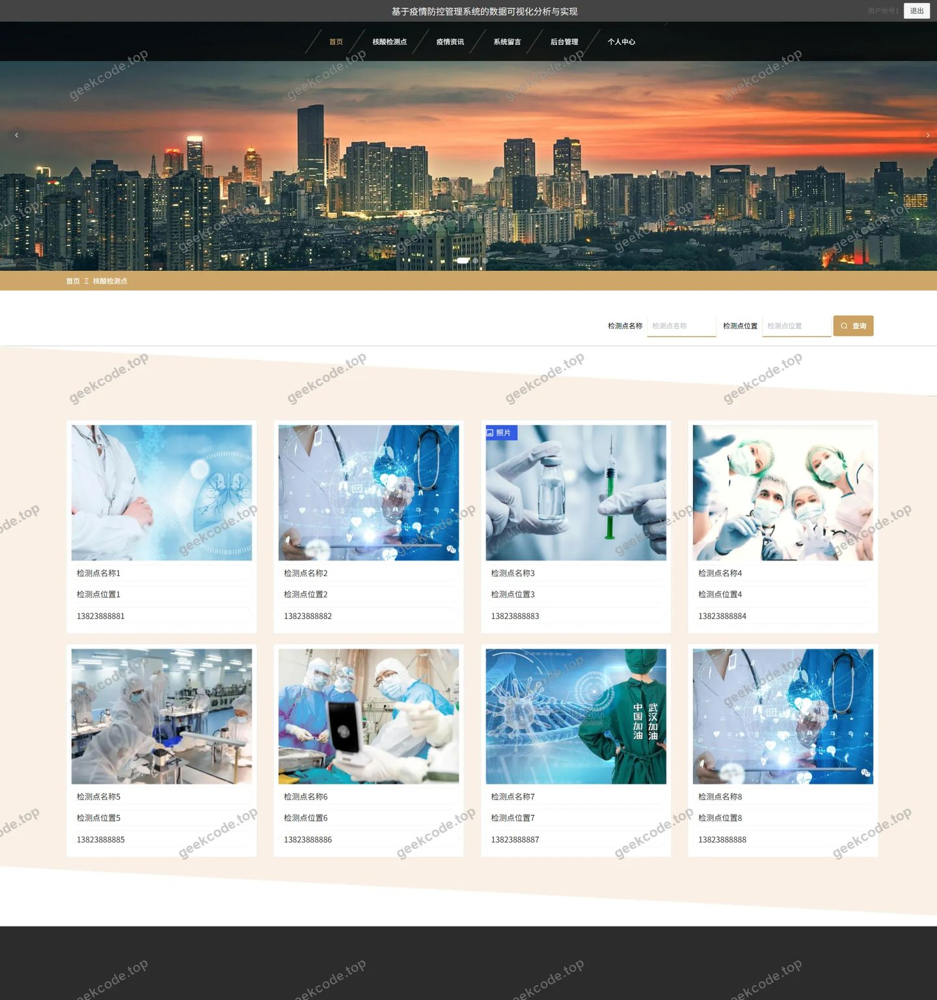</a>

<h4>前台-核酸检测预约列表</h4>

<a href="https://geekcode.top/archives/%E5%9F%BA%E4%BA%8E%E7%96%AB%E6%83%85%E9%98%B2%E6%8E%A7%E7%AE%A1%E7%90%86%E7%B3%BB%E7%BB%9F%E7%9A%84%E6%95%B0%E6%8D%AE%E5%8F%AF%E8%A7%86%E5%8C%96%E5%88%86%E6%9E%90%E4%B8%8E%E5%AE%9E%E7%8E%B03mkgh?utm_source=github" title="查看完整源码">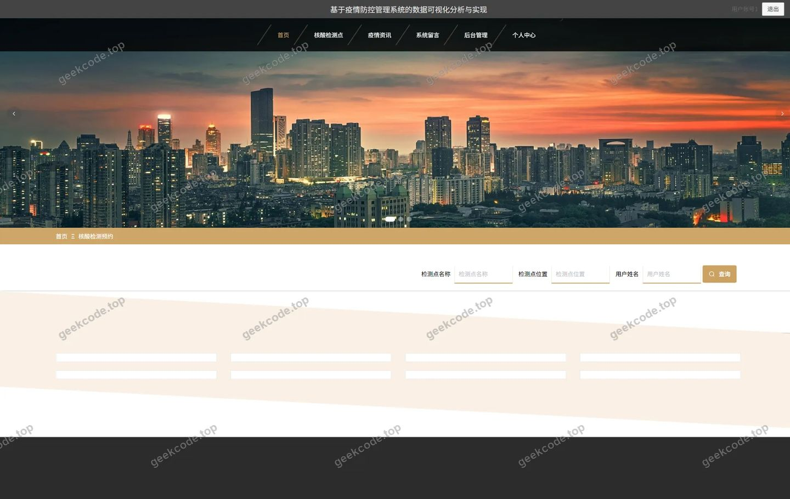</a>

<h4>前台-核酸结果列表</h4>

<a href="https://geekcode.top/archives/%E5%9F%BA%E4%BA%8E%E7%96%AB%E6%83%85%E9%98%B2%E6%8E%A7%E7%AE%A1%E7%90%86%E7%B3%BB%E7%BB%9F%E7%9A%84%E6%95%B0%E6%8D%AE%E5%8F%AF%E8%A7%86%E5%8C%96%E5%88%86%E6%9E%90%E4%B8%8E%E5%AE%9E%E7%8E%B03mkgh?utm_source=github" title="查看完整源码">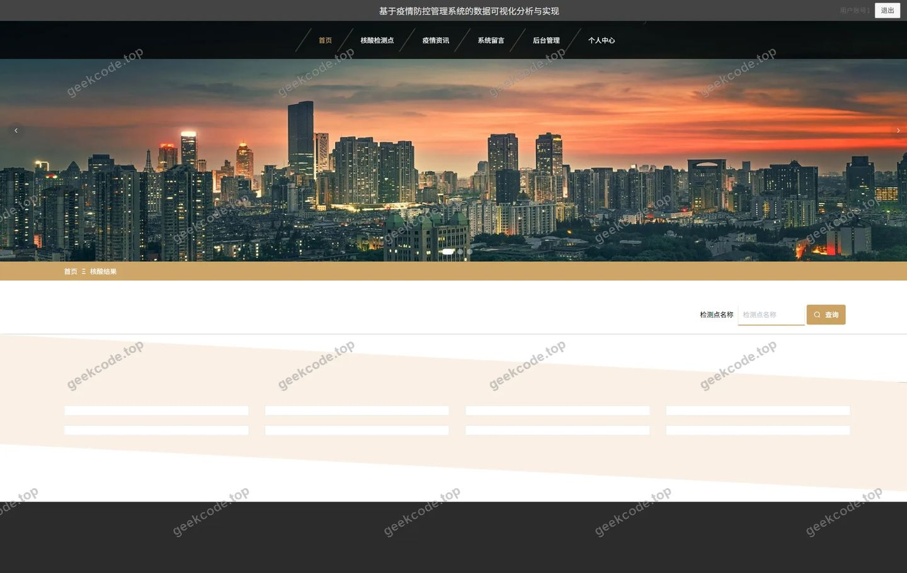</a>

<h4>前台-系统留言列表</h4>

<a href="https://geekcode.top/archives/%E5%9F%BA%E4%BA%8E%E7%96%AB%E6%83%85%E9%98%B2%E6%8E%A7%E7%AE%A1%E7%90%86%E7%B3%BB%E7%BB%9F%E7%9A%84%E6%95%B0%E6%8D%AE%E5%8F%AF%E8%A7%86%E5%8C%96%E5%88%86%E6%9E%90%E4%B8%8E%E5%AE%9E%E7%8E%B03mkgh?utm_source=github" title="查看完整源码">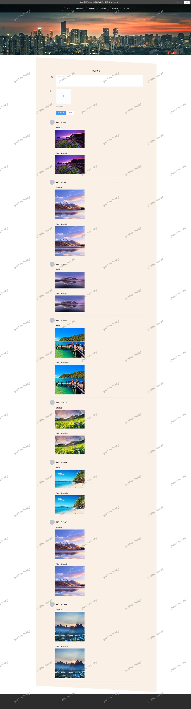</a>

<h4>前台-全国实时数据列表</h4>

<h4>前台-个人中心</h4>

<a href="https://geekcode.top/archives/%E5%9F%BA%E4%BA%8E%E7%96%AB%E6%83%85%E9%98%B2%E6%8E%A7%E7%AE%A1%E7%90%86%E7%B3%BB%E7%BB%9F%E7%9A%84%E6%95%B0%E6%8D%AE%E5%8F%AF%E8%A7%86%E5%8C%96%E5%88%86%E6%9E%90%E4%B8%8E%E5%AE%9E%E7%8E%B03mkgh?utm_source=github" title="查看完整源码">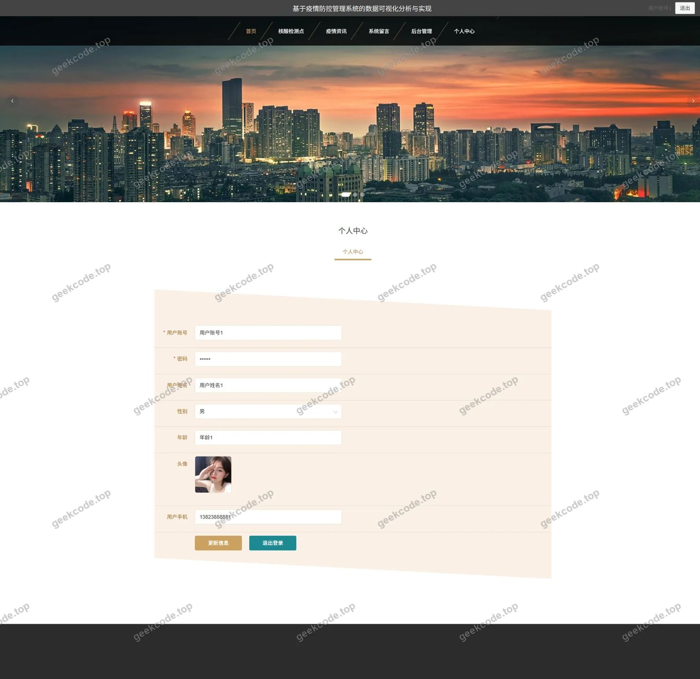</a>

<h4>前台-公告列表</h4>

<a href="https://geekcode.top/archives/%E5%9F%BA%E4%BA%8E%E7%96%AB%E6%83%85%E9%98%B2%E6%8E%A7%E7%AE%A1%E7%90%86%E7%B3%BB%E7%BB%9F%E7%9A%84%E6%95%B0%E6%8D%AE%E5%8F%AF%E8%A7%86%E5%8C%96%E5%88%86%E6%9E%90%E4%B8%8E%E5%AE%9E%E7%8E%B03mkgh?utm_source=github" title="查看完整源码">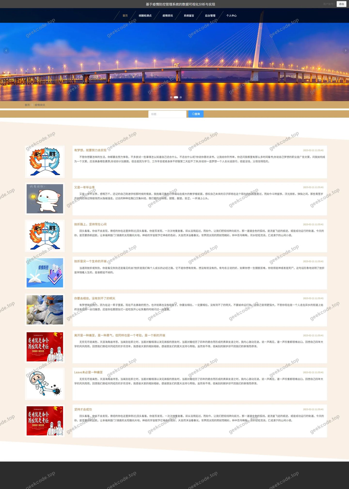</a>

<h3>后台管理端</h3>
<h4>后台-关于我们</h4>

<a href="https://geekcode.top/archives/%E5%9F%BA%E4%BA%8E%E7%96%AB%E6%83%85%E9%98%B2%E6%8E%A7%E7%AE%A1%E7%90%86%E7%B3%BB%E7%BB%9F%E7%9A%84%E6%95%B0%E6%8D%AE%E5%8F%AF%E8%A7%86%E5%8C%96%E5%88%86%E6%9E%90%E4%B8%8E%E5%AE%9E%E7%8E%B03mkgh?utm_source=github" title="查看完整源码">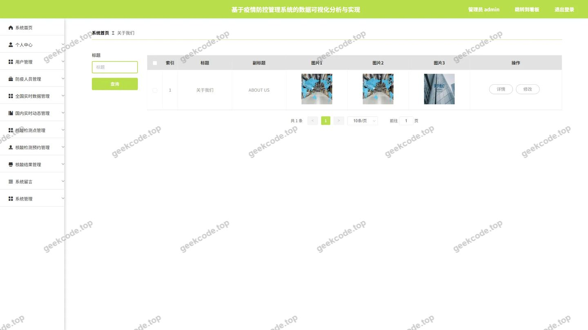</a>

<h4>后台-board</h4>

<a href="https://geekcode.top/archives/%E5%9F%BA%E4%BA%8E%E7%96%AB%E6%83%85%E9%98%B2%E6%8E%A7%E7%AE%A1%E7%90%86%E7%B3%BB%E7%BB%9F%E7%9A%84%E6%95%B0%E6%8D%AE%E5%8F%AF%E8%A7%86%E5%8C%96%E5%88%86%E6%9E%90%E4%B8%8E%E5%AE%9E%E7%8E%B03mkgh?utm_source=github" title="查看完整源码">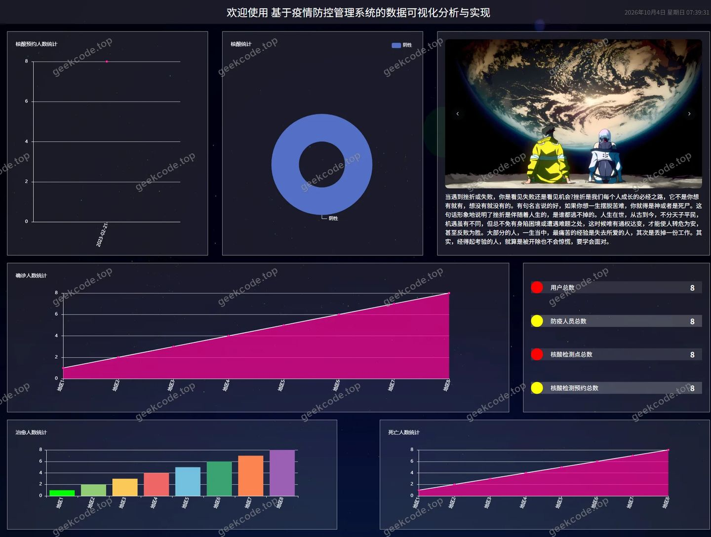</a>

<h4>后台-系统配置</h4>

<a href="https://geekcode.top/archives/%E5%9F%BA%E4%BA%8E%E7%96%AB%E6%83%85%E9%98%B2%E6%8E%A7%E7%AE%A1%E7%90%86%E7%B3%BB%E7%BB%9F%E7%9A%84%E6%95%B0%E6%8D%AE%E5%8F%AF%E8%A7%86%E5%8C%96%E5%88%86%E6%9E%90%E4%B8%8E%E5%AE%9E%E7%8E%B03mkgh?utm_source=github" title="查看完整源码">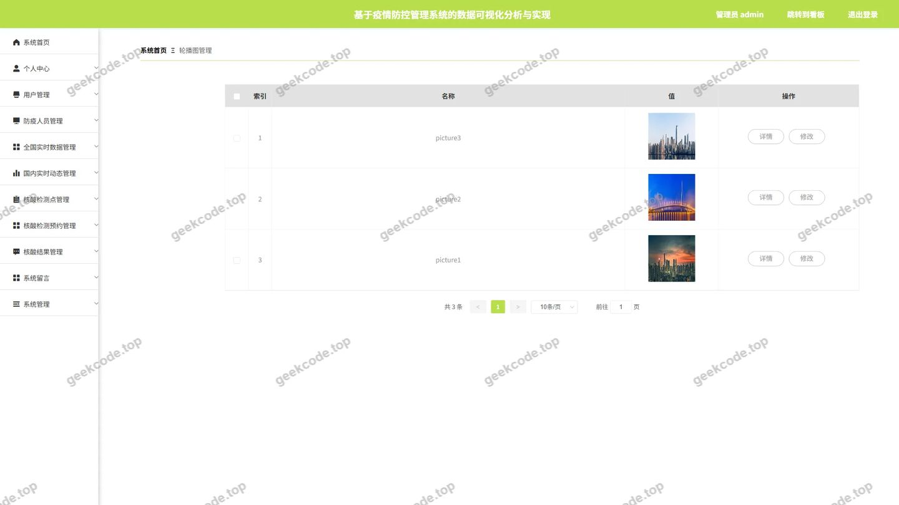</a>

<h4>后台-防疫人员</h4>

<a href="https://geekcode.top/archives/%E5%9F%BA%E4%BA%8E%E7%96%AB%E6%83%85%E9%98%B2%E6%8E%A7%E7%AE%A1%E7%90%86%E7%B3%BB%E7%BB%9F%E7%9A%84%E6%95%B0%E6%8D%AE%E5%8F%AF%E8%A7%86%E5%8C%96%E5%88%86%E6%9E%90%E4%B8%8E%E5%AE%9E%E7%8E%B03mkgh?utm_source=github" title="查看完整源码">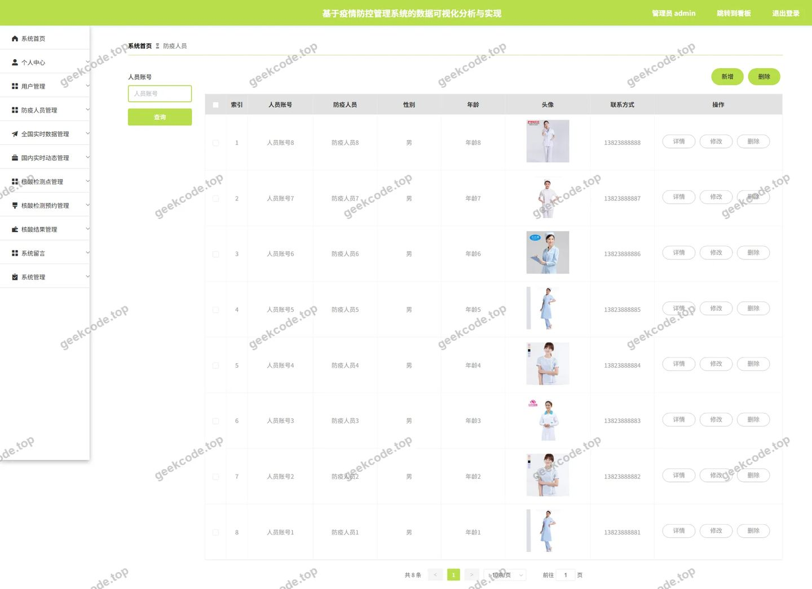</a>

<h4>后台-国内实时动态</h4>

<a href="https://geekcode.top/archives/%E5%9F%BA%E4%BA%8E%E7%96%AB%E6%83%85%E9%98%B2%E6%8E%A7%E7%AE%A1%E7%90%86%E7%B3%BB%E7%BB%9F%E7%9A%84%E6%95%B0%E6%8D%AE%E5%8F%AF%E8%A7%86%E5%8C%96%E5%88%86%E6%9E%90%E4%B8%8E%E5%AE%9E%E7%8E%B03mkgh?utm_source=github" title="查看完整源码">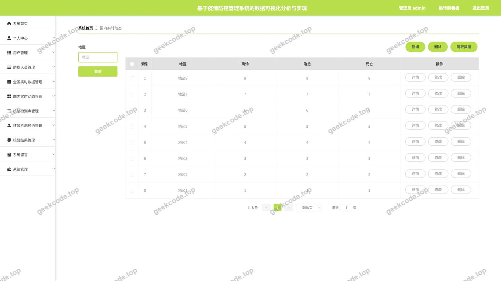</a>

<h4>后台-核酸检测点</h4>

<a href="https://geekcode.top/archives/%E5%9F%BA%E4%BA%8E%E7%96%AB%E6%83%85%E9%98%B2%E6%8E%A7%E7%AE%A1%E7%90%86%E7%B3%BB%E7%BB%9F%E7%9A%84%E6%95%B0%E6%8D%AE%E5%8F%AF%E8%A7%86%E5%8C%96%E5%88%86%E6%9E%90%E4%B8%8E%E5%AE%9E%E7%8E%B03mkgh?utm_source=github" title="查看完整源码">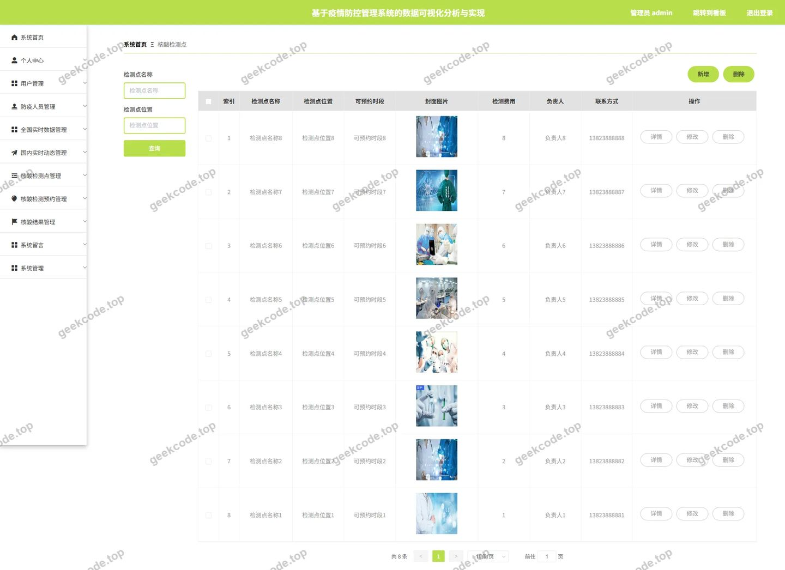</a>

<h4>后台-核酸检测预约</h4>

<a href="https://geekcode.top/archives/%E5%9F%BA%E4%BA%8E%E7%96%AB%E6%83%85%E9%98%B2%E6%8E%A7%E7%AE%A1%E7%90%86%E7%B3%BB%E7%BB%9F%E7%9A%84%E6%95%B0%E6%8D%AE%E5%8F%AF%E8%A7%86%E5%8C%96%E5%88%86%E6%9E%90%E4%B8%8E%E5%AE%9E%E7%8E%B03mkgh?utm_source=github" title="查看完整源码">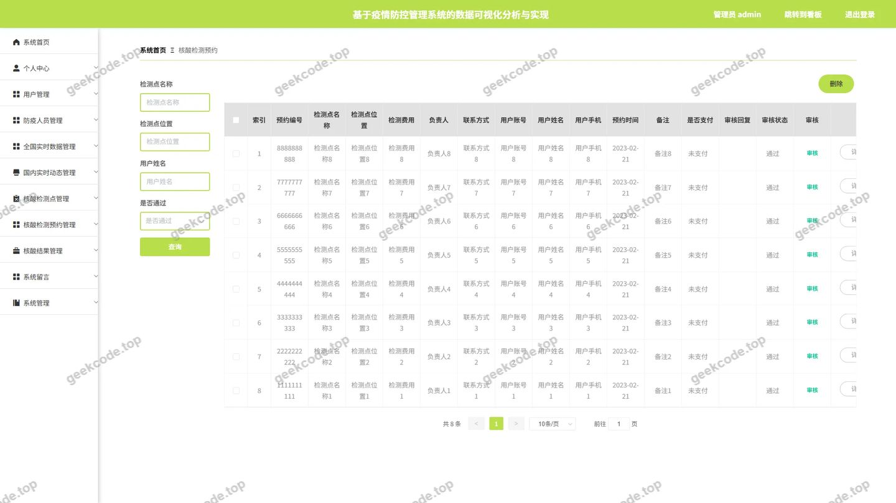</a>

<h4>后台-核酸结果</h4>

<a href="https://geekcode.top/archives/%E5%9F%BA%E4%BA%8E%E7%96%AB%E6%83%85%E9%98%B2%E6%8E%A7%E7%AE%A1%E7%90%86%E7%B3%BB%E7%BB%9F%E7%9A%84%E6%95%B0%E6%8D%AE%E5%8F%AF%E8%A7%86%E5%8C%96%E5%88%86%E6%9E%90%E4%B8%8E%E5%AE%9E%E7%8E%B03mkgh?utm_source=github" title="查看完整源码">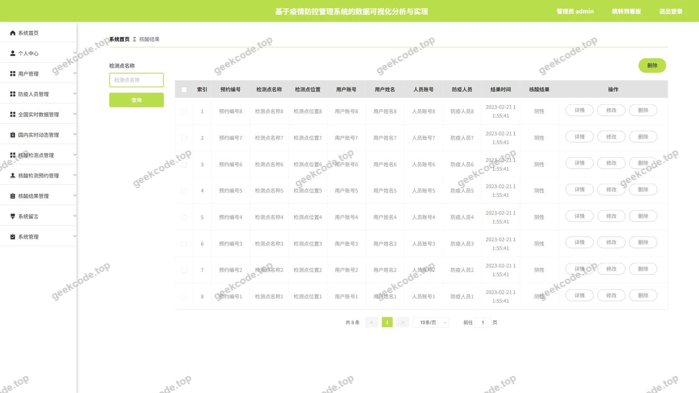</a>

<h4>后台首页</h4>

<a href="https://geekcode.top/archives/%E5%9F%BA%E4%BA%8E%E7%96%AB%E6%83%85%E9%98%B2%E6%8E%A7%E7%AE%A1%E7%90%86%E7%B3%BB%E7%BB%9F%E7%9A%84%E6%95%B0%E6%8D%AE%E5%8F%AF%E8%A7%86%E5%8C%96%E5%88%86%E6%9E%90%E4%B8%8E%E5%AE%9E%E7%8E%B03mkgh?utm_source=github" title="查看完整源码">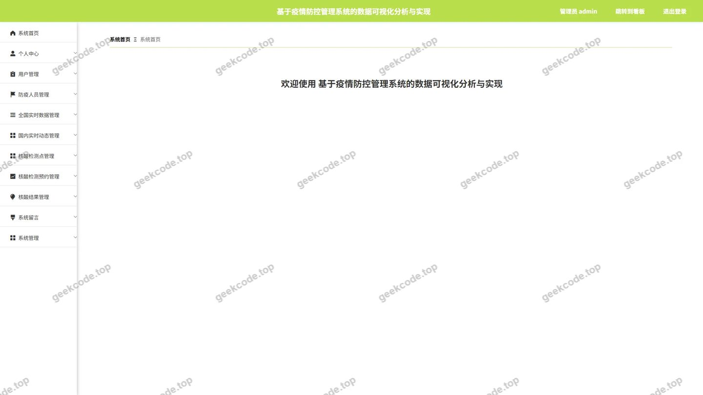</a>

<h4>后台-登录</h4>

<a href="https://geekcode.top/archives/%E5%9F%BA%E4%BA%8E%E7%96%AB%E6%83%85%E9%98%B2%E6%8E%A7%E7%AE%A1%E7%90%86%E7%B3%BB%E7%BB%9F%E7%9A%84%E6%95%B0%E6%8D%AE%E5%8F%AF%E8%A7%86%E5%8C%96%E5%88%86%E6%9E%90%E4%B8%8E%E5%AE%9E%E7%8E%B03mkgh?utm_source=github" title="查看完整源码">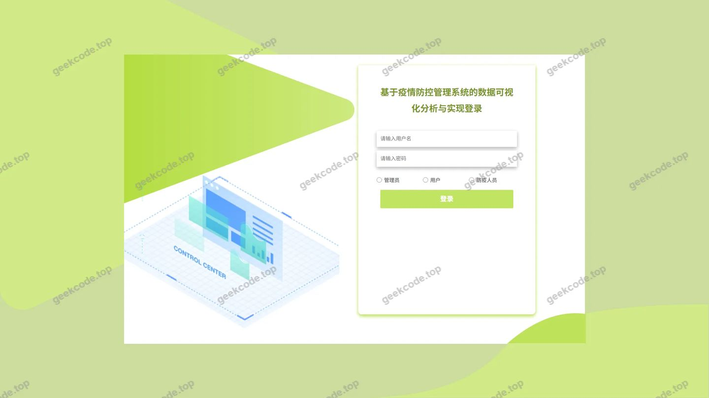</a>

<h4>后台-留言板</h4>

<a href="https://geekcode.top/archives/%E5%9F%BA%E4%BA%8E%E7%96%AB%E6%83%85%E9%98%B2%E6%8E%A7%E7%AE%A1%E7%90%86%E7%B3%BB%E7%BB%9F%E7%9A%84%E6%95%B0%E6%8D%AE%E5%8F%AF%E8%A7%86%E5%8C%96%E5%88%86%E6%9E%90%E4%B8%8E%E5%AE%9E%E7%8E%B03mkgh?utm_source=github" title="查看完整源码">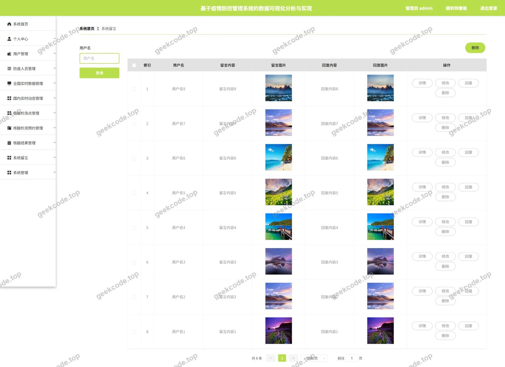</a>

<h4>后台-公告信息</h4>

<a href="https://geekcode.top/archives/%E5%9F%BA%E4%BA%8E%E7%96%AB%E6%83%85%E9%98%B2%E6%8E%A7%E7%AE%A1%E7%90%86%E7%B3%BB%E7%BB%9F%E7%9A%84%E6%95%B0%E6%8D%AE%E5%8F%AF%E8%A7%86%E5%8C%96%E5%88%86%E6%9E%90%E4%B8%8E%E5%AE%9E%E7%8E%B03mkgh?utm_source=github" title="查看完整源码">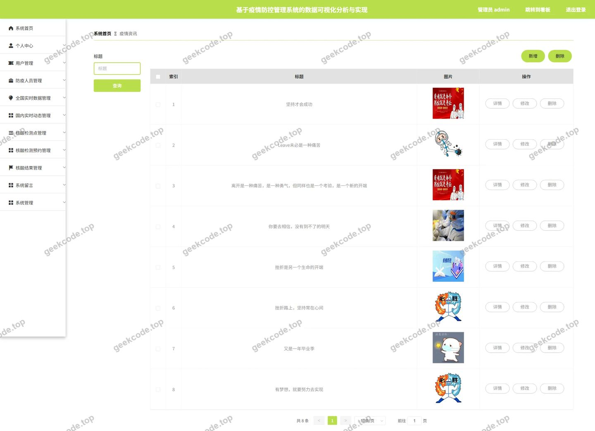</a>

<h4>后台-全国实时数据</h4>

<a href="https://geekcode.top/archives/%E5%9F%BA%E4%BA%8E%E7%96%AB%E6%83%85%E9%98%B2%E6%8E%A7%E7%AE%A1%E7%90%86%E7%B3%BB%E7%BB%9F%E7%9A%84%E6%95%B0%E6%8D%AE%E5%8F%AF%E8%A7%86%E5%8C%96%E5%88%86%E6%9E%90%E4%B8%8E%E5%AE%9E%E7%8E%B03mkgh?utm_source=github" title="查看完整源码">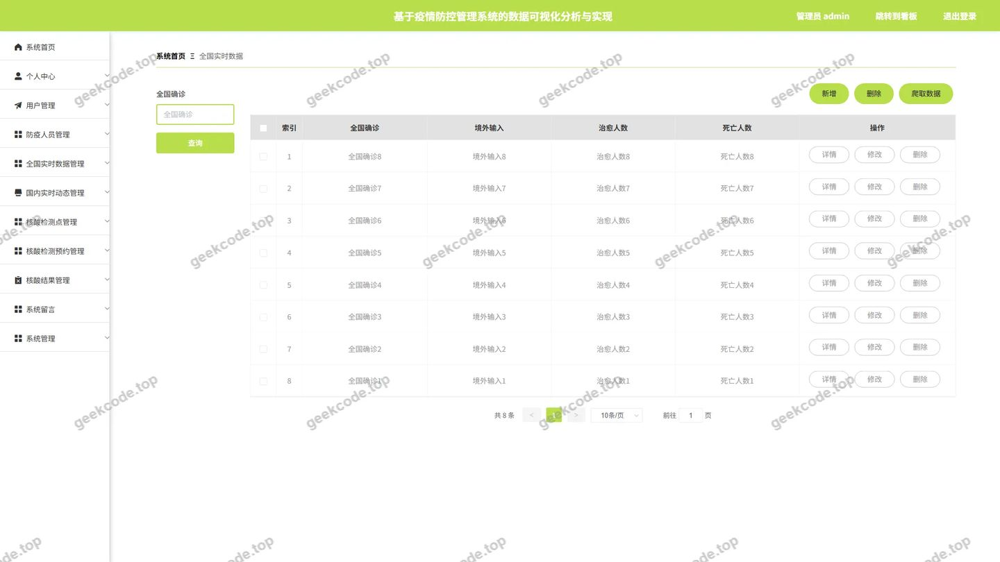</a>

---

## 获取完整源码

| 项目 | 说明 |
| --- | --- |
| 项目名 | 基于疫情防控管理系统的数据可视化分析与实现3mkgh |
| 运行截图 | 本文 23 张（站点带水印原图，仓库 `images/` 目录） |
| 完整源码 | [https://geekcode.top/archives/%E5%9F%BA%E4%BA%8E%E7%96%AB%E6%83%85%E9%98%B2%E6%8E%A7%E7%AE%A1%E7%90%86%E7%B3%BB%E7%BB%9F%E7%9A%84%E6%95%B0%E6%8D%AE%E5%8F%AF%E8%A7%86%E5%8C%96%E5%88%86%E6%9E%90%E4%B8%8E%E5%AE%9E%E7%8E%B03mkgh?utm_source=github](https://geekcode.top/archives/%E5%9F%BA%E4%BA%8E%E7%96%AB%E6%83%85%E9%98%B2%E6%8E%A7%E7%AE%A1%E7%90%86%E7%B3%BB%E7%BB%9F%E7%9A%84%E6%95%B0%E6%8D%AE%E5%8F%AF%E8%A7%86%E5%8C%96%E5%88%86%E6%9E%90%E4%B8%8E%E5%AE%9E%E7%8E%B03mkgh?utm_source=github) |
| 咨询微信 | **ir9372**（备注：jingpin-yuanma） |
| 更多项目 | [极客代码 geekcode.top](https://geekcode.top/?utm_source=github) |

> 需要源码、部署、改配置、跑不起来等问题，加微信 ir9372 沟通，说明项目名即可。
